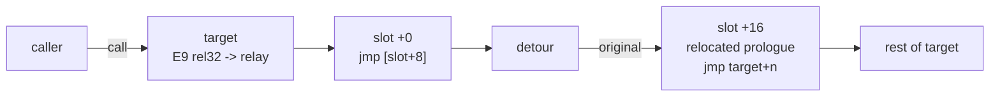

# Revenant

[](https://github.com/DaddyZyn/Revenant/actions/workflows/ci.yml)

x64 function hooking for Windows (C++20).

Rewrite of my older [Amnesia Hook](https://github.com/DaddyZyn/Amnesia-Hook). The engine, decoder and build
were redone and most of the old bugs are gone.

| Kind         | How it works                                                         | Code modified |
|--------------|----------------------------------------------------------------------|---------------|
| `Inline`     | 5-byte `jmp rel32` to a relay placed next to the trampoline         | 5+ bytes      |
| `Breakpoint` | DR0-DR3 hardware execute breakpoint + vectored exception handler    | none          |
| `HotPatch`   | MSVC hot-patch layout: 2-byte `jmp -7` into the 5-byte padding     | 2 + 5 pad     |
| `VTable`     | Swap of a single vtable slot                                         | none (data)   |

## Quick start

```cpp
#include <revenant/revenant.hpp>

using MessageBoxFn = decltype(&MessageBoxW);
revenant::Hook<MessageBoxFn> g_hook;

int WINAPI MyMessageBox(HWND hwnd, LPCWSTR text, LPCWSTR caption, UINT type) {
    return g_hook.Original()(hwnd, L"hooked!", caption, type);
}

int main() {
    g_hook = revenant::Hook<MessageBoxFn>(&MessageBoxW, &MyMessageBox);
    if (g_hook.Enable() != revenant::Status::Ok) return 1;
    MessageBoxW(nullptr, L"hello", L"Revenant", MB_OK);   // shows "hooked!"
}   // ~Hook removes the hook
```

Untyped:

```cpp
void* original = nullptr;
revenant::Status st = revenant::Create(&Target, &Detour, &original, revenant::Kind::Inline);
st = revenant::Enable(&Target);
// ...
st = revenant::Remove(&Target);
```

All functions return a `[[nodiscard]] revenant::Status`; `revenant::ToString` gives its name.

### API overview

| Function | Purpose |
|----------|---------|
| `Create(target, detour, &original, kind)` | Register a hook in the disabled state |
| `Enable` / `Disable` / `Remove` | Per-hook control |
| `EnableAll` / `DisableAll` / `RemoveAll` | All hooks, one thread-freeze window |
| `BeginBatch` / `CommitBatch` / `AbortBatch` | Queue `Enable`/`Disable` calls, apply them in one freeze |
| `IsHooked` / `IsEnabled` / `KindOf` / `OriginalOf` / `Count` | Queries |
| `VTableSlot(object, index)` | Address of a vtable entry, used as the target of a `VTable` hook |
| `ApplyBreakpointsToCurrentThread()` | Arm hardware breakpoints in a thread created after `Enable` (static builds) |
| `Shutdown()` | Remove everything and unregister the exception handler |
| `Hook<Fn>` | Typed, move-only RAII wrapper |

### Chaining

Creating a second `Inline` hook on the same target chains it: the new detour runs first and its `original` is the
previous detour. Only the relay pointer is swapped; the target is not repatched. `Remove` pops the most recent
detour, so chained hooks (including scoped `Hook<Fn>` objects) must be removed newest-first.

### VTable hooks

```cpp
void* slot = revenant::VTableSlot(object, 8);
revenant::Hook<PresentFn> hook(slot, &MyPresent, revenant::Kind::VTable);
hook.Enable();
```

The hook patches the vtable shared by every object of that class. To hook one function for every class that
uses it, inline-hook `*static_cast<void**>(slot)` instead.

### Graphics entry points

`REVENANT_GRAPHICS` is on by default. With it, `revenant::graphics::Find` creates a throwaway device and swap
chain on a hidden window, then returns the `Present` and resize entry points:

```cpp
revenant::graphics::Entries e;
if (revenant::graphics::Find(revenant::graphics::Api::D3D11, e) == revenant::Status::Ok)
    hook = revenant::Hook<PresentFn>(e.present, &MyPresent);
```

It supports `D3D9`, `D3D11`, `D3D12` and `OpenGL`. Every API is loaded dynamically, so Revenant itself never
links `d3d*.lib`. If the API's DLL isn't loaded in the process, `Find` returns `ModuleNotLoaded`.

`demo/overlay.cpp` is a complete example. It is a D3D11 window whose `Present` is hooked to draw an ImGui overlay.

## Building

Requires CMake 3.20+ and MSVC (Visual Studio 2022) for x64.

```powershell
cmake -S . -B build -A x64
cmake --build build --config Release
ctest --test-dir build -C Release
```

| Option | Default | Effect |
|--------|---------|--------|
| `REVENANT_SHARED` | `OFF` | Build `revenant.dll` instead of a static library |
| `REVENANT_GRAPHICS` | `ON` | Include `revenant::graphics` |
| `REVENANT_BUILD_TESTS` | top-level | Engine + decoder test suites |
| `REVENANT_BUILD_DEMO` | `OFF` | D3D11 + ImGui overlay demo |
| `REVENANT_INSTALL` | top-level | Install rules and CMake package |

### Using it from your project

```cmake
# vendored
add_subdirectory(Revenant)
target_link_libraries(app PRIVATE revenant::revenant)

# or fetched
include(FetchContent)
FetchContent_Declare(revenant GIT_REPOSITORY https://github.com/DaddyZyn/Revenant.git GIT_TAG main)
FetchContent_MakeAvailable(revenant)
target_link_libraries(app PRIVATE revenant::revenant)

# or installed (cmake --install build --prefix <dir>)
find_package(revenant 3 REQUIRED)
target_link_libraries(app PRIVATE revenant::revenant)
```

## How it works



Each hook owns a 128-byte **slot** that lies within +-2 GB of the target:

| Offset | Contents |
|--------|----------|
| `+0`   | relay: `FF 25 02 00 00 00` (`jmp [rip+2]`), `CC CC` |
| `+8`   | 8-byte-aligned detour pointer, swapped atomically for chaining |
| `+16`  | trampoline: relocated prologue followed by a jump back (`E9`, or a 14-byte absolute jump) |

Slots come from 64 KB blocks that are searched outward from the target, the same way MinHook does it. Blocks
are mapped `PAGE_EXECUTE_READ` and made writable only while a write is in progress.

### Relocation

The bundled `rvlde` length decoder handles legacy/REX/VEX/EVEX/XOP prefixes, 1-3 byte opcodes, ModRM/SIB,
displacements and immediates (checked against Capstone). While copying the prologue into the trampoline:

- RIP-relative operands are re-based. If the new displacement doesn't fit, `Create` fails with `Unrelocatable`.
- `jmp rel8/rel32` becomes `E9 rel32`, or a 14-byte absolute jump when the target is out of reach.
- `jcc rel8/rel32` becomes `0F 8x rel32`, or an inverted short `jcc` over an absolute jump.
- `call rel32` becomes `call rel32` when in reach. Otherwise it becomes `call [rip+2]; jmp +8; dq target`, so
  the call returns into the trampoline.
- `loop`/`jecxz`, and any branch back into the patched bytes, are refused (`Unrelocatable`).
- After an unconditional `ret`/`jmp`, the hook may only cover `CC`/`90`/`00` padding.

### Thread safety

Code patches are applied while every other thread is suspended. Instruction pointers that sit inside the
patched bytes are moved to the matching place in the trampoline, and the reverse happens on removal.
`EnableAll`, `DisableAll`, `RemoveAll` and `CommitBatch` each use one freeze window for all of their hooks.

Hardware breakpoints are per-thread. Revenant writes DR0-DR3/DR7 into every existing thread. The DLL build
also arms new threads in `DLL_THREAD_ATTACH`. In a static build, call `ApplyBreakpointsToCurrentThread()` from
threads created later. On a hit, the exception handler redirects `Rip` to the detour. `original` is a
trampoline, so the breakpoint is never hit again and no single-step is needed.

## Changes from Amnesia Hook

- Fixed: library didn't link (`d3d11.lib`), chained detours skipped, broken `jmp rel8`/far `call`/prefixed
  branch relocation, internal branches not detected, VMT disable/remove, x86-only hot-patch layout,
  per-hook freezes in batches, `DllMain` inside a namespace, demo never enabling its hook.
- Decoder replaced (VEX/EVEX/XOP support, several length fixes).
- New: `Hook<Fn>`, `VTable` kind, D3D9/D3D12/OpenGL finders, shared builds, CMake package, tests, CI.

## Limitations

- x64 Windows only.
- `Remove` frees the trampoline. Make sure no thread is still running inside a detour that will call `original`
  (for example, disable the hook first and let the calls drain).
- Hardware breakpoint hooks are limited to four, and anything else that writes debug registers can overwrite them.
- Only `Inline` hooks can be chained.

## License

MIT. See [LICENSE](LICENSE). Dear ImGui (`third_party/imgui`, used only by the demo) is MIT-licensed by Omar Cornut.
